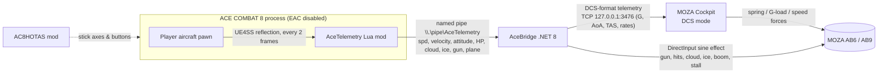

# AceCombat8MozaFFB (AceFFB): force feedback for ACE COMBAT 8 on MOZA AB6 / AB9 flight bases

**Version 0.3.0**. Download it from [Releases](https://github.com/lanzer/AceCombat8MozaFFB/releases).

## Main feature: every plane gets its own stick feel, automatically

When you pick a plane in AC8, its own MOZA Cockpit stick profile loads automatically. The
32 bundled presets give every AC8 plane its own spring, damper, weight and rumble strength:
heavy, old-school stick loads on the Phantom and Tomcat, a light fly-by-wire feel on fifth-gen
fighters, and a soft, twitchy stick on the experimental jets. Fifth-gen fighters are always
stronger in AC8, so the older jets are easy to ignore. Giving each one its own feel makes them
worth flying again.

> **Required:** turn on **auto switch presets** in MOZA Cockpit's settings, and install the presets
> with `scripts\Install-CockpitPresets.ps1` (it backs up your preset library first). See
> [AC8 Cockpit presets](#ac8-cockpit-presets-ab6).

AceFFB gives ACE COMBAT 8: Wings of Theve (PC/Steam) real force feedback on a **MOZA AB6 or AB9** FFB flight base.
It was tested on the AB6. The AB9 should work the same way because it uses the same MOZA Cockpit telemetry and
DirectInput force-feedback path, and AceBridge picks any force-feedback device whose name contains `MOZA`. AC8 has no FFB output of its own. AceFFB reads the
player aircraft's state from inside the game and turns it into:

- **Stick loading from G and speed.** MOZA Cockpit's DCS telemetry mode handles this. AceBridge
  presents AC8 as a DCS aircraft, so Cockpit's spring, G-load and airspeed feel work as usual.
  It picks a matching Cockpit aircraft profile for the plane you're flying.
- **Rumble effects** that AceBridge plays directly on the base through DirectInput:
  - gun fire (only while you're actually firing)
  - hits, in three tiers: light (bullets), heavy (missile or collision), destroyed
  - cloud buffet, scaled by cloud density
  - icing
  - a sonic boom pulse when you cross Mach 1
  - stall shake below a configurable speed (default 200 km/h)

> ⚠️ **Anti-cheat / ban risk.** This uses a UE4SS script mod, which requires launching AC8 with
> **Easy Anti-Cheat disabled**. Use it **only in the offline single-player campaign**. Never go
> into ACE COMBAT ONLINE / multiplayer with UE4SS installed or EAC bypassed. Remove or disable
> the mods and restore the normal EAC launch first. Bandai Namco has no published policy on mods.
> **You use this at your own risk.**

## Requirements

| What | Notes |
|---|---|
| ACE COMBAT 8 (Steam, Windows 11) | Offline campaign, launched with EAC disabled (see the warning above) |
| UE4SS **v3.0.1 Beta (Git SHA 03dbd5c0)** | The build tested with AC8 (UE 5.4). The AC8HOTAS "full install" package bundles this exact build. Other UE4SS builds are untested. |
| [AC8 HOTAS Support](https://github.com/Drumsmasher17/AC8HOTAS) (recommended) | Lets the game read the AB6 directly as a flight stick, so you don't need an Xbox-controller emulator. Its INSTALL guide also covers launching with EAC disabled. |
| .NET 8 **Desktop** Runtime (x64) | Only needed for the framework-dependent build. Not needed for a `-SelfContained` build. Install the SDK if you build it yourself. |
| MOZA Cockpit (tested 1.1.4.38) | Its **DCS** telemetry mode supplies the stick loading |
| DCS World (free) installed | MOZA Cockpit's DCS mode expects DCS. Leave it idle at the **main menu**, not in a mission. |
| MOZA AB6 or AB9 FFB base | Tested on the AB6. The AB9 should work the same (same MOZA Cockpit / DirectInput path, untested). Rumble uses the first DirectInput force-feedback device whose name contains "MOZA" (`Vibration.cs`), so no device-specific setup is needed. |

## Install

1. **UE4SS.** Install UE4SS v3.0.1 Beta into `ACE COMBAT 8\Game\Binaries\Win64` so you have
   `Win64\dwmapi.dll` and `Win64\UE4SS\`. The easiest route is the AC8HOTAS full-install package.
   Set up the EAC-disabled launch as described by AC8HOTAS / the AC8 modding community.
2. **AceTelemetry mod.** Copy `mod\AceTelemetry` (or `Mods\AceTelemetry` from the release zip) to
   `ACE COMBAT 8\Game\Binaries\Win64\UE4SS\Mods\AceTelemetry`, then add this line to
   `UE4SS\Mods\mods.txt`:
   ```text
   AceTelemetry : 1
   ```
3. **MOZA Cockpit port.** Edit Cockpit's DCS export script so it uses port 3476. The exact edit is
   in [dcs/MOZA-lua-port.md](dcs/MOZA-lua-port.md).
4. **AceBridge.** Download the release zip and extract it anywhere, or build it yourself:
   ```powershell
   powershell -ExecutionPolicy Bypass -File scripts\build.ps1            # needs .NET 8 SDK
   powershell -ExecutionPolicy Bypass -File scripts\build.ps1 -SelfContained
   ```
   The output goes to `release\AceFFB-<version>\` along with a zip for a GitHub Release.
5. **Optional: AB6/AB9 bindings (AC8HOTAS).** The example was made on an AB6; AB9 button numbers may differ.
   It includes Start/Menu (the mod's `Pause` action, Button49), air brake / speed control (`AccelDecel`,
   Button3), level flight / auto-level (`AutoPilot`, Button52), squadron commands on the in-flight hat
   (`HatUp/Right/Down/Left`, Buttons 12-15, with the same buttons also bound to `DPad*` for menus and dialogs), camera view cycle third-person / HUD / cockpit
   (`View`, Button16), camera look on the grip thumbstick
   (`CameraYaw` = Rx, `CameraPitch` = Ry with `invert = true`, which makes view up/down follow the
   flight stick, push forward = look down; set it to `false` for a non-inverted view) and, for setups without a separate throttle,
   `Throttle` on the AB6 base slider (`Slider2`). **Comment out the Throttle line if the game already
   supports your throttle natively** (e.g. T.Flight HOTAS 4). See
   [examples/AC8HOTAS-bindings-AB6.lua](examples/AC8HOTAS-bindings-AB6.lua). **Replace the device
   GUID with your own** (the file explains how), copy it to `Mods\AC8HOTAS\bindings.lua`, select
   *Expert* flight controls in game, then press **F5**. Turn off any Xbox-controller emulator so the
   game doesn't read the stick twice.

   **Alternative layout:** [examples/AC8HOTAS-bindings-AB6-trigger-missile.lua](examples/AC8HOTAS-bindings-AB6-trigger-missile.lua)
   is unconventional: missiles fire from the trigger's second stage instead of the big red top button, and
   target select sits right under the resting thumb. Your thumb never has to move, which keeps your aim much
   steadier while firing missiles and switching targets. Face buttons are on 12-15, the D-pad and squadron
   commands on 7-10, and weapon change on 21.

## MOZA throttle and rudder pedals (untested)

This setup hasn't been tested yet. If you try a MOZA throttle (or any separate throttle) and/or
rudder pedals with AC8HOTAS, please report what worked on the
[GitHub issues page](https://github.com/lanzer/AceCombat8MozaFFB/issues).

AceBridge's force feedback isn't affected; only the game's input bindings change. Everything is
configured in `Mods\AC8HOTAS\bindings.lua`:

1. Plug the devices in and start AC8 once with AC8HOTAS enabled (or press **F5** in game). The bottom of
   `bindings.lua`, between `BEGIN DETECTED DEVICES` and `END DETECTED DEVICES`, then lists every controller
   with its `device = "{GUID}"` and the axes it exposes (`X`, `Y`, `Z`, `Rx`, `Ry`, `Rz`, `Slider1`,
   `Slider2`).
2. To find which axis is the throttle lever or the rudder, move it in **MOZA Cockpit** or in Windows
   **Game Controllers** (`Win+R`, `joy.cpl`, then Properties) and see which axis moves. Some MOZA peripherals
   may show up inside the AB6/AB9 base device rather than as a separate controller. In that case use the
   base's GUID with the axis that moves.
3. Point `Throttle` and `Yaw` at those devices and axes (the GUIDs below are placeholders):

   ```lua
   Throttle = { device = "{THROTTLE-GUID-FROM-DETECTED-LIST}", input = "Z", invert = false, mode = "zero_to_one" },
   Yaw      = { device = "{PEDALS-GUID-FROM-DETECTED-LIST}",   input = "Rz", invert = false },
   ```

4. **Remove (or set to `nil`) the example's AB6 lines** for `Throttle` (`Slider2`) and `Yaw` (`Rz`). Each
   action can only be listed once in `bindings.lua`, and you don't want the stick's slider and twist also
   driving throttle and yaw.
5. Save, press **F5** in game, and read the newest `Mods\AC8HOTAS\HOTAS-*.log`. "Config accepted" means it
   applied. If an axis runs the wrong way, flip `invert` and press F5 again.

What the AC8HOTAS README says about multiple devices, and what to watch for:

- **One config can span several devices.** AC8HOTAS says "Multiple devices can be mapped directly; a
  combined virtual joystick is not required", and its example config assigns buttons and axes across
  multiple HOTAS devices. Each action, though, binds to exactly one device and input.
- **Devices with the same product ID can't be mapped separately** ("Controllers sharing the same product ID
  cannot currently be mapped separately").
- **A newly assigned device may need a USB reconnect.** The game caches device associations, so if a new
  device does nothing after F5, unplug and replug it, then press F5 again.
- **Profile slots:** the mod puts each device into one of the game's built-in flight-stick profiles. If no
  free profile has slots for all the actions you gave a device, F5 is rejected and the log names the
  missing actions or says no unoccupied profile fits. Its INSTALL notes say restarting the game with the
  completed config can let a different profile be picked, but that isn't guaranteed.
- **A throttle the game already supports natively** (e.g. T.Flight HOTAS 4) needs no AC8HOTAS binding.
  Leave `Throttle` unbound for it.

## Run order

1. **MOZA Cockpit**: select **DCS** and press **Start game**.
2. **DCS World**: start it and leave it at the main menu.
3. **AceBridge**: run `Start-AceBridge.cmd`. The window should show
   `[vib] vibration channel ready on MOZA AB6 FFB Base` (or your AB9) and `[tcp] Cockpit connected`.
4. **ACE COMBAT 8** (EAC disabled). When you're in a mission, AceBridge shows
   `[pipe] game mod connected` and `[map] plane ... -> Cockpit profile ...`, followed by `[live]`
   status lines every 2 seconds.

You can start or restart AceBridge while the game is running; the mod reconnects by itself.

**Hot reload:** after editing `Mods\AceTelemetry\Scripts\main.lua`, press **Ctrl+R** in game to
reload UE4SS Lua mods. Force feedback comes back after a few seconds.

## Tuning

Command-line options for AceBridge, passed through `Start-AceBridge.cmd` (for example
`Start-AceBridge.cmd --vib 0.8`):

| Option | Default | Meaning |
|---|---|---|
| `--vib <scale>` | `1.0` | Overall strength of all rumble effects (0–1+) |
| `--stall-kmh <kmh>` | `200` | Stall shake starts below this speed and grows stronger as you slow down. It only applies once airborne (after exceeding this speed + 120 km/h). |
| `--map <file>` | see below | Path to `aircraft-map.json` |
| `--aircraft <profile>` | `FA-18C-AC8` | Cockpit profile used before a plane is identified (AC8-only Hornet copy from `cockpit-presets/`) |
| `--port <n>` | `3476` | TCP port MOZA Cockpit connects to (must match MOZA.lua) |
| `--no-cockpit` | off | Rumble only, without MOZA Cockpit. No G/speed stick loading. |

Settings that are code constants. Edit them and rebuild, or for the Lua file, press Ctrl+R:

| Setting | Where |
|---|---|
| Gun detection window (0.14 s) | `GUN_WINDOW` in `mod/AceTelemetry/Scripts/main.lua` |
| Per-effect strength and frequency: gun 0.30, cloud 0.22, ice 0.38, stall 0.42 | `Vibration.Update` in `bridge/AceBridge/Vibration.cs` (`Take(level * strength, periodMs)`) |
| Hit pulses: light 0.35, heavy 0.65 (≥10 % health lost), destroyed 0.85 | `Vib?.Pulse(...)` calls in `bridge/AceBridge/Program.cs` |
| Sonic boom pulse 0.42 (Mach 1 = 340 m/s, re-arms below Mach 0.93) | `Vib?.Pulse(0.42, 100, 280)` in `Program.cs` |
| G smoothing and clamp (−4…+12 G) | `Serve()` in `Program.cs` |

G/speed stick loading strength is configured in **MOZA Cockpit** (DCS telemetry settings for the
mapped aircraft profile), not in AceBridge.

## Aircraft map

`config/aircraft-map.json` (copied next to `AceBridge.exe` in the release) maps AC8 plane codes to
MOZA Cockpit aircraft profiles (the AC8-only names from `cockpit-presets/`, see below). The plane code comes from the player pawn class
`BP_PlayerPlane_PPxxxx_<code>_C`, lower-cased, with leading zeros in numbers removed. The **first
matching prefix wins**, so put more specific entries (for example `f15e`) before shorter ones
(`f15`). Unknown planes use `default`, and AceBridge logs
`[map] no mapping for '<code>' ... Add it to aircraft-map.json`. AceBridge reads the file at start-up.

AceBridge looks for the file in this order: `--map`, then next to the exe, then `..\config\`, then
the repo `config\` folder (when run from `bin\`), then `.\config\`.

## AC8 Cockpit presets (AB6)

`cockpit-presets/` holds an arcade-tuned MOZA Cockpit preset for every AC8 plane (AB6, DCS
mode). Each one uses an **AC8-only aircraft name** (for example `F-22A`, `Su-57`, `F-15C-AC8`,
`FA-18C-AC8`), and `config/aircraft-map.json` only ever sends those names. Every preset has a
centering spring of at least 8, so the stick still re-centers in tunnel runs.

**Required:** in MOZA Cockpit's settings, turn on **auto switch presets**. Otherwise Cockpit
receives the AC8 aircraft name but stays on whatever preset was loaded last, so the per-plane
presets never switch in.

Each preset's **game FFB gain** (`bacic_gameForceFeedback`) sets how strong AceBridge's own rumble is
(gun, hits, clouds, icing, sonic boom, stall). It must be above 0, or the rumble is muted. The presets
use 100 for fighters, 70–80 for heavy jets, fifth-gen and experimental planes, and 40 for attack jets.

### How the presets are tuned

The goal is that every plane feels different when you switch, while every stick still re-centers.
Every preset uses full stick travel and keeps G loading on, so the stick still gets heavier when
you pull hard.

- **Older jets follow their DCS presets.** Where MOZA ships a DCS preset for the plane, its damper,
  friction, inertia and breakout are kept. Most DCS jet presets are "force feedback" presets with
  spring 0, because DCS supplies the centering itself; AC8 doesn't, so the spring is set to half of
  that preset's game FFB gain (minimum 8). That puts the Tomcat and Phantom around 50, the MiG-21
  and MiG-29 at 43, the Strike Eagle at 35 and the A-10 at 20. The Hornet keeps its official 50/60.
- **Planes without a DCS preset** start from their closest relative and get small differences, for
  example the F/A-18F and EA-18G a little heavier than the Hornet, and the F-15C and F-15J a little
  lighter than the Strike Eagle. The F-14D is about 5% lighter than the F-14A.
- **Fly-by-wire 4.5-gen jets** (F-16C, F-2A, Typhoon, Rafale M, Gripen E, Su-35S) get a lighter
  stick: spring 25–30, damper 16–22 and little friction or inertia. The F-16C uses full travel instead
  of the official preset's 15%.
- **Fifth-gen jets** get a low spring and damper (around 20) to imitate fly-by-wire, where the plane
  isn't fighting back, which makes small corrections easier. The F-22 is the dogfighter, with
  thrust vectoring, so it gets slightly more spring (22) and rumble (80). The F-35 is more of a
  bomber, so it gets less (spring 18, rumble 70). The Su-57 (21) and Su-47 (20) sit in between.
- **Experimental jets** (FA-36, EA-36, X-40) get the lightest stick of all: spring and damper 15,
  friction and inertia 3, rumble 70, very late stall and light stall buffet.
- **Rumble (game FFB gain)** is 100 for fighters. Heavier planes get less: about 70 for the A-6E,
  EA-6B, Su-34 and MiG-31, and 40 for the A-10 and Su-25.

You can change any value in Cockpit while you fly; your edits stay in your own copy of the preset.

### Changes (2026-10-14, v0.3.0)

- **Headline:** per-plane automatic profile switching. Picking a plane in AC8 loads its own Cockpit preset (needs Cockpit's "auto switch presets" on).
- Per-plane stick feel replaces the old one-size spring of 60–70, which was too stiff to fly.
- The F-14A and F-14D now have separate presets.
- Game FFB gain was 0 in every preset, which muted the bridge's rumble; it's now set per plane.
- The bridge's fallback profile is `FA-18C-AC8`, so it never asks Cockpit for a real DCS profile.
- The release build now includes `cockpit-presets/` and the install/uninstall scripts.

**Your real DCS profiles stay as they are.** The installer only adds new names to Cockpit's
auto-match table and never overwrites an existing key, so DCS aircraft such as `FA-18C_hornet` or
`F-16C_50` keep their official MOZA presets.

Install (PowerShell, from the repo or release folder):

```powershell
powershell -ExecutionPolicy Bypass -File scripts\Install-CockpitPresets.ps1
```

The script:
1. Backs up `Documents\MOZA Cockpit\PresetLibrary` to `PresetLibrary-backup-<date>`.
2. Closes MOZA Cockpit.
3. Copies the presets into the library and adds them to `PresetIndex.index` and `OptimalMatch.vconfig`
   (under AB6 > dcs_world). Existing entries are merged, never replaced.
4. Restarts Cockpit.

To remove them, run `scripts\Uninstall-CockpitPresets.ps1`. It deletes only the presets named
`AC8 ...` along with their index and auto-match entries, and it makes another backup first. You can
also restore any `PresetLibrary-backup-<date>` folder by hand. Tuning was tested on the AB6. The AB9
uses different presets (RS21), so these may not apply to it.

## Tip: twisting the stick for yaw

If you use the AB6's twist axis for yaw, the force-feedback return spring makes twisting hard work. Wrap badminton grip tape around the middle of the stick, where your thumb, middle finger and ring finger rest. The extra grip lets you twist with much less force and cuts down on fatigue.

## Troubleshooting

- **AceBridge window freezes or stops updating.** This was caused by Windows console QuickEdit:
  clicking in the window paused the process. AceBridge now disables QuickEdit at start-up. If you
  still see it, press Esc or Enter in the window.
- **No stick loading (G/speed) checklist:**
  1. AceBridge shows `[tcp] Cockpit connected`. If not: is Cockpit on DCS with Start game pressed?
     Is MOZA.lua set to port 3476 (see [dcs/MOZA-lua-port.md](dcs/MOZA-lua-port.md))? Is DCS at
     the main menu rather than in a mission?
  2. `[pipe] game mod connected`. If not: check `AceTelemetry : 1` in `mods.txt`, that UE4SS
     loaded (its console or `UE4SS.log` shows `[AceTelemetry] loaded v2`), and that EAC is disabled.
  3. The `[live]` lines show `G=` changing when you pull. If they show `no aircraft`, you're in a
     menu, cutscene or loading screen. Output is paused there on purpose.
  4. Cockpit's telemetry FFB is enabled for the profile shown by `[map]`.
- **No rumble:** look for the `[vib] ...` line at start-up. It should name your MOZA base (AB6 or AB9). `no MOZA force-feedback device found` means DirectInput lists no FFB device with "MOZA" in its name. Rumble needs exclusive DirectInput access
  to the base, so close other FFB tools. Unplugging and replugging the base and restarting
  AceBridge usually fixes `init failed`.
- **AC8HOTAS bindings don't apply:** press **F5** in game and read the newest
  `Mods\AC8HOTAS\HOTAS-*.log`. A newly assigned device can need a **USB unplug/replug** followed
  by F5. Use *Expert* flight controls. If you get "lacks requested action slots: X", remove action
  X from bindings.lua.
- **Pitch is reversed:** set `invert = true` (or `false`) on `Pitch` and press F5.
- **Yaw doesn't work:** on the AB6 (check the AC8HOTAS detected list for the AB9), yaw/twist is the **Rz** axis ("Z Rotation" in Windows), not Z.
  Bind `Yaw = { device = "...", input = "Rz" }`. If yaw still feels on/off instead of proportional,
  also install AC8AnalogYaw (bundled with AC8HOTAS).
- **Gun rumble lingers or stutters:** adjust `GUN_WINDOW` in main.lua and press Ctrl+R. The UE4SS
  console prints the measured `rounds/s` when you release the trigger.

## How it works



- **AceTelemetry** (`mod/`) finds the player pawn through possession hooks, so it never scans
  objects while a map is loading. Roughly 30 times a second it writes one line:
  speed, world velocity, pitch/yaw/roll, health, missile alert, throttle, cloud/ice state, gun
  firing and plane code. Gun fire is detected from newly spawned `BP_plwp_gun_*` round actors.
- **AceBridge** (`bridge/`) calculates G-load, angle of attack, sideslip and angular rates from
  successive samples. It serves these to MOZA Cockpit as a DCS export stream and picks the Cockpit
  aircraft profile from `aircraft-map.json`. It also plays one continuously updated DirectInput
  sine effect on the base for the rumble effects.

## Credits

- [UE4SS (RE-UE4SS)](https://github.com/UE4SS-RE/RE-UE4SS), the Unreal Engine scripting system
  this mod runs on (MIT).
- [AC8 HOTAS Support / AC8HOTAS](https://github.com/Drumsmasher17/AC8HOTAS) by Drumsmasher17
  (also on [Nexus Mods](https://www.nexusmods.com/acecombat8wingsoftheve/mods/8)), for direct
  stick/throttle bindings. Bundled with [AC8AnalogueYaw](https://github.com/Drumsmasher17/AC8AnalogueYaw).
- [SharpDX.DirectInput](https://www.nuget.org/packages/SharpDX.DirectInput) for DirectInput force feedback.
- MOZA Cockpit and its DCS telemetry export belong to MOZA Racing. This project doesn't
  redistribute MOZA's files.
- ACE COMBAT is a trademark of Bandai Namco Entertainment. This is an unofficial fan project
  and isn't affiliated with Bandai Namco or MOZA.

## License

[MIT](LICENSE) © 2026 Derek Liu.
