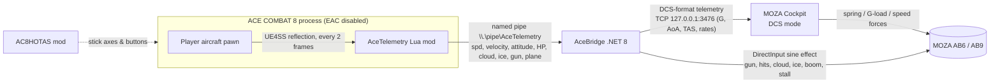

# AceCombat8MozaFFB (AceFFB): force feedback for ACE COMBAT 8 on MOZA AB6 / AB9 flight bases

AceFFB gives ACE COMBAT 8: Wings of Theve (PC/Steam) real force feedback on a **MOZA AB6 or AB9** FFB flight base.
It was tested on the AB6. The AB9 should work the same way because it uses the same MOZA Cockpit telemetry and
DirectInput force-feedback path, and AceBridge picks any force-feedback device whose name contains `MOZA`. AC8 has no FFB output of its own. AceFFB reads the
player aircraft's state from inside the game and turns it into:

- **Stick loading from G and speed.** MOZA Cockpit's DCS telemetry mode handles this. AceBridge
  presents AC8 as a DCS aircraft, so Cockpit's spring, G-load and airspeed feel work as usual.
  It picks a matching Cockpit aircraft profile for the plane you're flying.
- **Rumble effects** that AceBridge plays directly on the base through DirectInput:
  - gun fire (only while you're actually firing)
  - hits, in three tiers: light (bullets), heavy (missile or collision), destroyed
  - cloud buffet, scaled by cloud density
  - icing
  - a sonic boom pulse when you cross Mach 1
  - stall shake below a configurable speed (default 200 km/h)

> ⚠️ **Anti-cheat / ban risk.** This uses a UE4SS script mod, which requires launching AC8 with
> **Easy Anti-Cheat disabled**. Use it **only in the offline single-player campaign**. Never go
> into ACE COMBAT ONLINE / multiplayer with UE4SS installed or EAC bypassed. Remove or disable
> the mods and restore the normal EAC launch first. Bandai Namco has no published policy on mods.
> **You use this at your own risk.**

## Requirements

| What | Notes |
|---|---|
| ACE COMBAT 8 (Steam, Windows 11) | Offline campaign, launched with EAC disabled (see the warning above) |
| UE4SS **v3.0.1 Beta (Git SHA 03dbd5c0)** | The build tested with AC8 (UE 5.4). The AC8HOTAS "full install" package bundles this exact build. Other UE4SS builds are untested. |
| [AC8 HOTAS Support](https://github.com/Drumsmasher17/AC8HOTAS) (recommended) | Lets the game read the AB6 directly as a flight stick, so you don't need an Xbox-controller emulator. Its INSTALL guide also covers launching with EAC disabled. |
| .NET 8 **Desktop** Runtime (x64) | Only needed for the framework-dependent build. Not needed for a `-SelfContained` build. Install the SDK if you build it yourself. |
| MOZA Cockpit (tested 1.1.4.38) | Its **DCS** telemetry mode supplies the stick loading |
| DCS World (free) installed | MOZA Cockpit's DCS mode expects DCS. Leave it idle at the **main menu**, not in a mission. |
| MOZA AB6 or AB9 FFB base | Tested on the AB6. The AB9 should work the same (same MOZA Cockpit / DirectInput path, untested). Rumble uses the first DirectInput force-feedback device whose name contains "MOZA" (`Vibration.cs`), so no device-specific setup is needed. |

## Install

1. **UE4SS.** Install UE4SS v3.0.1 Beta into `ACE COMBAT 8\Game\Binaries\Win64` so you have
   `Win64\dwmapi.dll` and `Win64\UE4SS\`. The easiest route is the AC8HOTAS full-install package.
   Set up the EAC-disabled launch as described by AC8HOTAS / the AC8 modding community.
2. **AceTelemetry mod.** Copy `mod\AceTelemetry` (or `Mods\AceTelemetry` from the release zip) to
   `ACE COMBAT 8\Game\Binaries\Win64\UE4SS\Mods\AceTelemetry`, then add this line to
   `UE4SS\Mods\mods.txt`:
   ```text
   AceTelemetry : 1
   ```
3. **MOZA Cockpit port.** Edit Cockpit's DCS export script so it uses port 3476. The exact edit is
   in [dcs/MOZA-lua-port.md](dcs/MOZA-lua-port.md).
4. **AceBridge.** Download the release zip and extract it anywhere, or build it yourself:
   ```powershell
   powershell -ExecutionPolicy Bypass -File scripts\build.ps1            # needs .NET 8 SDK
   powershell -ExecutionPolicy Bypass -File scripts\build.ps1 -SelfContained
   ```
   The output goes to `release\AceFFB-<version>\` along with a zip for a GitHub Release.
5. **Optional: AB6/AB9 bindings (AC8HOTAS).** The example was made on an AB6; AB9 button numbers may differ.
   It includes Start/Menu (the mod's `Pause` action, Button52), air brake / speed control (`AccelDecel`,
   Button3), level flight / auto-level (`AutoPilot`, Button49) and, for setups without a separate throttle,
   `Throttle` on the AB6 base slider (`Slider2`). **Comment out the Throttle line if the game already
   supports your throttle natively** (e.g. T.Flight HOTAS 4). See
   [examples/AC8HOTAS-bindings-AB6.lua](examples/AC8HOTAS-bindings-AB6.lua). **Replace the device
   GUID with your own** (the file explains how), copy it to `Mods\AC8HOTAS\bindings.lua`, select
   *Expert* flight controls in game, then press **F5**. Turn off any Xbox-controller emulator so the
   game doesn't read the stick twice.

## Run order

1. **MOZA Cockpit**: select **DCS** and press **Start game**.
2. **DCS World**: start it and leave it at the main menu.
3. **AceBridge**: run `Start-AceBridge.cmd`. The window should show
   `[vib] vibration channel ready on MOZA AB6 FFB Base` (or your AB9) and `[tcp] Cockpit connected`.
4. **ACE COMBAT 8** (EAC disabled). When you're in a mission, AceBridge shows
   `[pipe] game mod connected` and `[map] plane ... -> Cockpit profile ...`, followed by `[live]`
   status lines every 2 seconds.

You can start or restart AceBridge while the game is running; the mod reconnects by itself.

**Hot reload:** after editing `Mods\AceTelemetry\Scripts\main.lua`, press **Ctrl+R** in game to
reload UE4SS Lua mods. Force feedback comes back after a few seconds.

## Tuning

Command-line options for AceBridge, passed through `Start-AceBridge.cmd` (for example
`Start-AceBridge.cmd --vib 0.8`):

| Option | Default | Meaning |
|---|---|---|
| `--vib <scale>` | `1.0` | Overall strength of all rumble effects (0–1+) |
| `--stall-kmh <kmh>` | `200` | Stall shake starts below this speed and grows stronger as you slow down. It only applies once airborne (after exceeding this speed + 120 km/h). |
| `--map <file>` | see below | Path to `aircraft-map.json` |
| `--aircraft <profile>` | `FA-18C_hornet` | Cockpit profile used before a plane is identified |
| `--port <n>` | `3476` | TCP port MOZA Cockpit connects to (must match MOZA.lua) |
| `--no-cockpit` | off | Rumble only, without MOZA Cockpit. No G/speed stick loading. |

Settings that are code constants. Edit them and rebuild, or for the Lua file, press Ctrl+R:

| Setting | Where |
|---|---|
| Gun detection window (0.14 s) | `GUN_WINDOW` in `mod/AceTelemetry/Scripts/main.lua` |
| Per-effect strength and frequency: gun 0.30, cloud 0.22, ice 0.38, stall 0.42 | `Vibration.Update` in `bridge/AceBridge/Vibration.cs` (`Take(level * strength, periodMs)`) |
| Hit pulses: light 0.35, heavy 0.65 (≥10 % health lost), destroyed 0.85 | `Vib?.Pulse(...)` calls in `bridge/AceBridge/Program.cs` |
| Sonic boom pulse 0.42 (Mach 1 = 340 m/s, re-arms below Mach 0.93) | `Vib?.Pulse(0.42, 100, 280)` in `Program.cs` |
| G smoothing and clamp (−4…+12 G) | `Serve()` in `Program.cs` |

G/speed stick loading strength is configured in **MOZA Cockpit** (DCS telemetry settings for the
mapped aircraft profile), not in AceBridge.

## Aircraft map

`config/aircraft-map.json` (copied next to `AceBridge.exe` in the release) maps AC8 plane codes to
MOZA Cockpit DCS aircraft profiles. The plane code comes from the player pawn class
`BP_PlayerPlane_PPxxxx_<code>_C`, lower-cased, with leading zeros in numbers removed. The **first
matching prefix wins**, so put more specific entries (for example `f15e`) before shorter ones
(`f15`). Unknown planes use `default`, and AceBridge logs
`[map] no mapping for '<code>' ... Add it to aircraft-map.json`. AceBridge reads the file at start-up.

AceBridge looks for the file in this order: `--map`, then next to the exe, then `..\config\`, then
the repo `config\` folder (when run from `bin\`), then `.\config\`.

## Troubleshooting

- **AceBridge window freezes or stops updating.** This was caused by Windows console QuickEdit:
  clicking in the window paused the process. AceBridge now disables QuickEdit at start-up. If you
  still see it, press Esc or Enter in the window.
- **No stick loading (G/speed) checklist:**
  1. AceBridge shows `[tcp] Cockpit connected`. If not: is Cockpit on DCS with Start game pressed?
     Is MOZA.lua set to port 3476 (see [dcs/MOZA-lua-port.md](dcs/MOZA-lua-port.md))? Is DCS at
     the main menu rather than in a mission?
  2. `[pipe] game mod connected`. If not: check `AceTelemetry : 1` in `mods.txt`, that UE4SS
     loaded (its console or `UE4SS.log` shows `[AceTelemetry] loaded v2`), and that EAC is disabled.
  3. The `[live]` lines show `G=` changing when you pull. If they show `no aircraft`, you're in a
     menu, cutscene or loading screen. Output is paused there on purpose.
  4. Cockpit's telemetry FFB is enabled for the profile shown by `[map]`.
- **No rumble:** look for the `[vib] ...` line at start-up. It should name your MOZA base (AB6 or AB9). `no MOZA force-feedback device found` means DirectInput lists no FFB device with "MOZA" in its name. Rumble needs exclusive DirectInput access
  to the base, so close other FFB tools. Unplugging and replugging the base and restarting
  AceBridge usually fixes `init failed`.
- **AC8HOTAS bindings don't apply:** press **F5** in game and read the newest
  `Mods\AC8HOTAS\HOTAS-*.log`. A newly assigned device can need a **USB unplug/replug** followed
  by F5. Use *Expert* flight controls. If you get "lacks requested action slots: X", remove action
  X from bindings.lua.
- **Pitch is reversed:** set `invert = true` (or `false`) on `Pitch` and press F5.
- **Yaw doesn't work:** on the AB6 (check the AC8HOTAS detected list for the AB9), yaw/twist is the **Rz** axis ("Z Rotation" in Windows), not Z.
  Bind `Yaw = { device = "...", input = "Rz" }`. If yaw still feels on/off instead of proportional,
  also install AC8AnalogYaw (bundled with AC8HOTAS).
- **Gun rumble lingers or stutters:** adjust `GUN_WINDOW` in main.lua and press Ctrl+R. The UE4SS
  console prints the measured `rounds/s` when you release the trigger.

## How it works



- **AceTelemetry** (`mod/`) finds the player pawn through possession hooks, so it never scans
  objects while a map is loading. Roughly 30 times a second it writes one line:
  speed, world velocity, pitch/yaw/roll, health, missile alert, throttle, cloud/ice state, gun
  firing and plane code. Gun fire is detected from newly spawned `BP_plwp_gun_*` round actors.
- **AceBridge** (`bridge/`) calculates G-load, angle of attack, sideslip and angular rates from
  successive samples. It serves these to MOZA Cockpit as a DCS export stream and picks the Cockpit
  aircraft profile from `aircraft-map.json`. It also plays one continuously updated DirectInput
  sine effect on the base for the rumble effects.

## Credits

- [UE4SS (RE-UE4SS)](https://github.com/UE4SS-RE/RE-UE4SS), the Unreal Engine scripting system
  this mod runs on (MIT).
- [AC8 HOTAS Support / AC8HOTAS](https://github.com/Drumsmasher17/AC8HOTAS) by Drumsmasher17
  (also on [Nexus Mods](https://www.nexusmods.com/acecombat8wingsoftheve/mods/8)), for direct
  stick/throttle bindings. Bundled with [AC8AnalogueYaw](https://github.com/Drumsmasher17/AC8AnalogueYaw).
- [SharpDX.DirectInput](https://www.nuget.org/packages/SharpDX.DirectInput) for DirectInput force feedback.
- MOZA Cockpit and its DCS telemetry export belong to MOZA Racing. This project doesn't
  redistribute MOZA's files.
- ACE COMBAT is a trademark of Bandai Namco Entertainment. This is an unofficial fan project
  and isn't affiliated with Bandai Namco or MOZA.

## License

[MIT](LICENSE) © 2026 Derek Liu.
